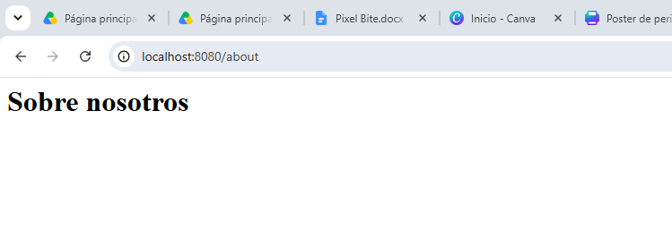
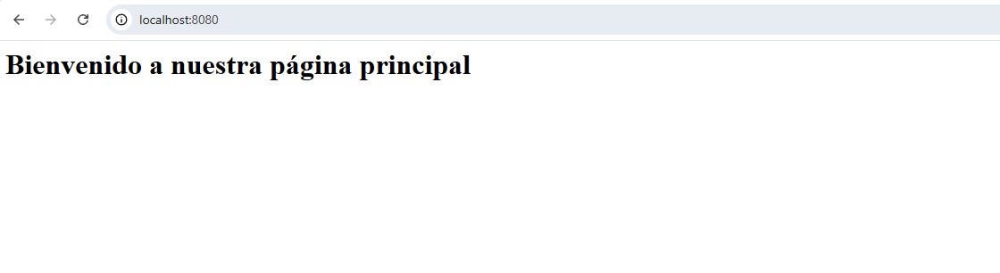
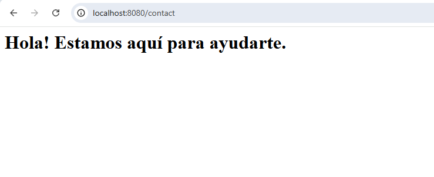

# Tema 01: Instalación con Docker

| | |
|---|---|
| **Fecha de inicio** | 09/11/2026 |
| **Fecha de fin** | 19/11/2026 |
| **Tiempo dedicado** | 4 horas |
| **Rama de Git** | `tema01` |

---

## 1. 🎯 Objetivo del tema

Instalación del proyecto con Docker y creación del proyecto laravel

---

## 2. 🛠️ Desarrollo paso a paso

<!-- Un apartado por cada paso importante. Para cada uno:
     - Qué haces y POR QUÉ.
     - El comando o el código, en un bloque de código (nunca como captura).
     - Una captura solo si aporta algo visual (navegador, resultado, estructura...). -->

### 2.1 Creación de vistas

Se van a crear tres vistas llamadas home, about y contact

Vista *about.blade.php*


Vista *home.blade.php*


Vista *contact.blade.php*

### 2.2 Definición de rutas

```php
 Route::view('/', 'home')->name('home');
 Route::view('/about', 'about')->name('about');
 Route::view('/contact', 'contact')->name('contact');
```


---

## 3. 📋 Resumen de comandos utilizados

| Comando | Para qué sirve |
|---------|----------------|
| `php artisan ...` | Herramienta de línea de comandos de Laravel: crea componentes, gestiona rutas, limpia caché, ejecuta migraciones, etc. |
| `composer ...` | Gestor de dependencias de PHP: crea el proyecto Laravel e instala o actualiza sus librerías |
| `docker-compose` | Levanta, reinicia y detiene los contenedores del proyecto (nginx y PHP) definidos en `docker-compose.yml` |


---

## 4. 🐞 Problemas encontrados y soluciones

<!-- Documenta TODOS los problemas, aunque te parezcan tontos.
     Copia el error como texto, no como captura.
     Si no has tenido ningún problema, documenta al menos algo que hayas tenido que investigar. -->

### Problema 1: Comprobación del funcionamiento de laravel después de su instalación

**Qué estaba haciendo:** Comprobar el correcto funcionamiento de laravel una vez creaod el proyecto básico.

**Error:**

```
Acceso denegado
```

**Causa:** problema de permisos

**Solución:**
Ejecutamos en la terminal los siguientes comandos

```bash
docker exec -it proyecto-php-1 bash
	php artisan key:generate
	chmod -R 775 storage bootstrap/cache
	chown -R www-data:www-data storage bootstrap/cache
```
Posteriormente será necesario añadir el fichero *.env* la siguiente configuración

```
bash
DB_HOST=mysql
DB_PORT=3306
DB_DATABASE=test
DB_USERNAME=alumno
DB_PASSWORD=alumno
SESSION_DRIVER=file
```

**Fuente:** chatgpt

### Problema 2: [Descripción corta]

Tuve un fallo al abrir las páginas de about y contact

**Causa:** Faltaba/Habia que cambiar unas lineas en la carpeta de  nginx -> default.conf
**Solución:** 
try_files $uri $uri/ /index.php?$query_string; 
index index.php;  

---

## 5. ✅ Resultado final

Vista *about.blade.php*


Vista *home.blade.php*


Vista *contact.blade.php*

---

## 6. 💭 Conclusiones

- **Qué he aprendido:** A definir rutas con `Route::view()` y nombrarlas para usarlas con `route()` en las vistas, y a montar Laravel sobre Docker con nginx y PHP-FPM.
- **Qué me ha costado más:** Averiguar por qué `/about` y `/contact` daban "File not found" y luego un 403. El problema estaba en la configuración de nginx: faltaba un espacio en `try_files` y la directiva `index index.php;`.
- **Qué haría diferente / dudas pendientes:** Revisaría antes la configuración del servidor y no solo el código de Laravel. Me queda pendiente entender mejor cómo se comunican nginx y PHP-FPM dentro de Docker.

---
